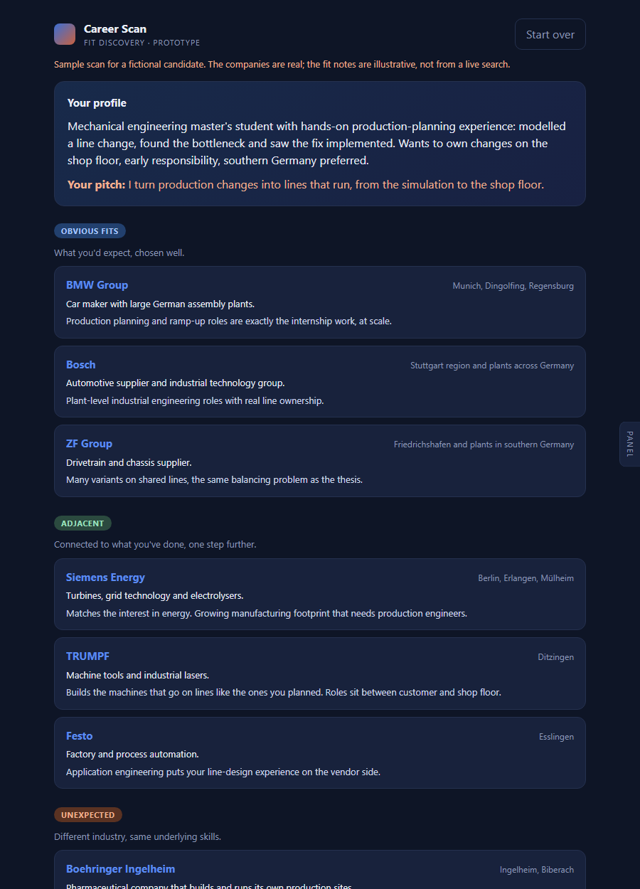

# careerscan

*Built with the help of Claude Code.*

A short AI interview that maps a student to employers: the obvious ones, the
adjacent ones, and, the point of the whole thing, employers in industries they
would never have searched, where their underlying skills are in demand.

**[Sample scan](https://wizzardofodds.github.io/careerscan/?demo)** (no key needed) ·
**[Run it](https://wizzardofodds.github.io/careerscan/)** with your own Anthropic API key



## Why

Most job platforms search by the industry you type in. A mechanical
engineer who has spent a summer balancing an assembly line searches
"automotive". But the same skills are just as valuable to a company
starting up a pharmaceutical filling line or a chip-packaging plant, and
those jobs never show up in the search.

I built the first version for my own job search. This repo is the
cleaned-up prototype.

## How it works

It's a static page with no backend. It calls the Claude API from the
browser with the user's own key, through the official SDK.

1. **Intake form + CV.** Six optional fields and PDF text extraction. Anything
   filled in here is one question fewer in the interview.
2. **Interview.** One question at a time, using revealed preference ("which
   part of the internship would you do again?") rather than self-rating, and
   forced choices between two equally good options for strengths.
3. **Profile.** The transcript is turned into a structured profile. The call
   uses `output_config.format` with a JSON schema, so the response is always
   valid JSON and needs no regex parsing.
4. **Two research passes in parallel, with web search.**
   - *expected and adjacent* employers
   - *unexpected* employers: this pass first rewrites the candidate's skills
     in industry-neutral terms, then is told to leave out every sector the
     candidate already named
5. **Format and validate.** Research notes → scan JSON (schema-constrained
   again) → `cleanScan()` drops anything vague or unlinked, and duplicates.

```
src/
  prompts.js   system prompts and JSON schemas
  engine.js    API calls: interview, profile, research (with pause_turn resume), format
  lib.js       pure helpers: escaping, URL checks, scan validation (unit-tested)
  app.js       UI
  demo.js      hand-written sample run for the no-key demo
```

## What changed from the first prototype

The first version worked end to end. Using it showed where it fell short:

- **The "unexpected" group wasn't unexpected.** Asked for all three groups
  at once, the model stayed inside the sectors the candidate had named.
  The fix is a separate pass that starts from industry-neutral skills and
  excludes the named sectors.
- **Categories instead of employers.** It sometimes returned "embedded
  systems companies (Bosch, Pilz adjacent)", which isn't something you can
  apply to. Every entry now needs a real name and a homepage, and the
  validator removes the rest.
- **Model output went into the page unescaped.** Company names and links
  from the model went into `innerHTML` with an escaper that didn't handle
  quotes, and any URL scheme was accepted, so a `javascript:` link would have
  run. Everything is now escaped, and links must be http(s).
- **The API key was kept in `localStorage`, and there was an option to embed
  a key in the file to send to friends.** Both are gone. The key now lives
  for the tab session only, unless the user explicitly ticks "remember".

## Run locally

```
python -m http.server 8000
# open http://localhost:8000/?demo
```

Tests (pure helpers only, no API calls):

```
npm test          # Node 18+
```

or open `tests/index.html` through the local server.

## Limitations

- A live scan costs real API credit, roughly $1 on Claude Opus 5 by my
  estimate. The model picker offers cheaper options.
- Matching is the model's judgement grounded in web search. There is no
  employer database and no fit score. For a real product the matching would
  need a shared skills vocabulary for both sides (e.g. ESCO) and data on
  employers, not per-user searches.
- Browser-direct API access means the key is in the page. That is fine for
  a tool you run with your own key, but not for a hosted product.
